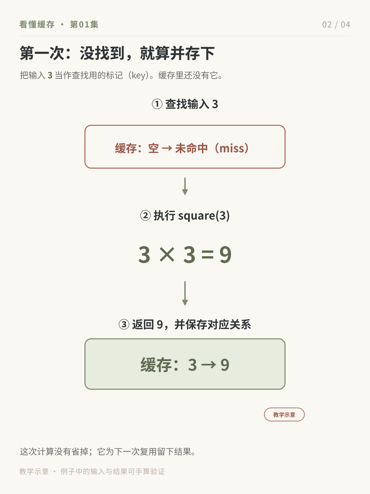

# Feynman Learning Skills

把一个具体问题讲清，再把已经学过的内容留下来。

这是 [77AutumN](https://github.com/77AutumN) 自用学习流程的公开版本：用 Agent 带读概念、论文或技术系统，明确收口后生成知识卡和自测，需要复习短稿时再整理成 900 字以内的精华。

| 阶段 | 技能 | 你会得到什么 |
| --- | --- | --- |
| 带读与收口 | `feynman-notes` | 小步讲解、学习进度、知识卡、自测 |
| 短稿复习 | `distill-learning-essence` | 有素材依据的短稿和不会覆盖旧稿的 revision |

“继续”表示继续讲；“这一节懂了，整理成卡片”才进入收口。直接要求整理已有材料也可以制作产物，但不能据此声称使用者已经理解。

## 先看一个完整例子

[缓存命中示例](examples/cache-hit/index.md) 展示：原始材料 → 一段带读对话 → 自测 → 卡片 → 精华。这里的对话是为演示编写的，不是真实用户的学习记录。



## 运行环境

首版只验证 Windows、Codex、Python 3.13 和 Chrome。其他系统或 Agent 尚未验证。需要能读取文件、执行 Python 的 Agent；仅粘贴进普通聊天窗口无法运行图片渲染和文件留存。

在 PowerShell 中克隆并安装 Python 依赖：

```powershell
git clone https://github.com/77AutumN/feynman-learning-skills.git
Set-Location .\feynman-learning-skills
python -m venv .venv
.\.venv\Scripts\python.exe -X utf8 -m pip install -r requirements.txt
```

直接 Python 依赖是 `PyYAML` 和 `jsonschema`，其依赖由 pip 安装。图片由本机 Chromium 浏览器渲染，中文字体随技能提供。渲染器优先找标准位置的 Chrome，其次是 Edge；其他位置可设置 `FEYNMAN_NOTES_EDGE` 为浏览器可执行文件的完整路径。

本机 Edge 154.0.4258.37 的无界面模式未返回布局预检结果，因此未通过本次验收；我们用已安装的 Chrome 完成验证。遇到浏览器预检失败时会停止，不跳过预检生成图片。

## 在 Codex 中使用

最快的试用方式：在本仓库打开 Codex，指定文件，不必先安装技能：

```text
先完整读取 skills/feynman-notes/SKILL.md 及它要求的引用。
带我读 examples/cache-hit/source.md，一轮只讲一个具体问题。
所有 Python 命令使用本仓库 .venv/Scripts/python.exe，并加 -X utf8。
```

进入自己的项目长期使用时，将两个目录安装到该项目的 `.agents/skills/`：

```powershell
$projectPath = 'C:\path\to\your-project'
New-Item -ItemType Directory -Path "$projectPath\.agents\skills" -Force | Out-Null
Copy-Item -LiteralPath .\skills\feynman-notes -Destination "$projectPath\.agents\skills" -Recurse
Copy-Item -LiteralPath .\skills\distill-learning-essence -Destination "$projectPath\.agents\skills" -Recurse
```

`$projectPath` 换成自己的项目路径；若已安装同名技能，先处理旧版本再复制。在目标项目打开新的 Codex 对话，调用：

```text
$feynman-notes 带我读这份材料：<文件路径>。
```

学完一节后：

```text
这一节懂了，整理成知识卡和费曼自测。
```

需要短稿时：

```text
$distill-learning-essence 把这一节的已完成笔记整理成 900 字以内的精华。
```

默认学习文件保存到使用项目的 `content/learning-notes/<series>/`，精华保存到 `artifacts/drafts/learning-essence/<series>/`。可以另指定学习目录。使用项目的 Python 也需要安装 `requirements.txt` 中的依赖。

## 不调用模型，先验证文件流程

在克隆目录运行：

```powershell
.\.venv\Scripts\python.exe -X utf8 examples/cache-hit/source.py
.\.venv\Scripts\python.exe -X utf8 examples/cache-hit/cards/render_cards.py --help
.\.venv\Scripts\python.exe -X utf8 examples/cache-hit/cards/render_cards.py --list
.\.venv\Scripts\python.exe -X utf8 examples/cache-hit/cards/render_cards.py 01
.\.venv\Scripts\python.exe -X utf8 examples/cache-hit/cards/render_cards.py --validate-manifest 01
.\.venv\Scripts\python.exe -X utf8 skills/distill-learning-essence/scripts/save_draft.py --workspace-root . --series cache-hit --episode 01 --topic "缓存命中" --body-file examples/cache-hit/essence.md --source examples/cache-hit/source.md --source examples/cache-hit/01-cache-hit.md
.\.venv\Scripts\python.exe -X utf8 -m unittest discover -s skills/distill-learning-essence/tests
.\.venv\Scripts\python.exe -X utf8 -m unittest discover -s skills/feynman-notes/tests
```

渲染会更新示例中的 PNG、HTML 和 manifest；保存精华会创建第一个空闲的 revision，重复运行不会覆盖旧稿。以上验证只检查示例和文件流程，不能证明你已经理解材料。实际检查结果见 [首版验收记录](docs/validation.md)。

## 方法边界

- 一节只围绕一个问题，小步展开；遇到听不懂的动作就重讲。
- 知识卡呈现已经核实的机制与边界，图片生成成功不等于内容正确。
- 自测记录真实作答；没有作答就写未作答，示例答案不冒充使用者的话。
- 900 字按 Unicode code point 计数，包括标题、空格和换行，不等同于某个平台的字数统计。
- 索引保存进度。产物制作完成与使用者理解确认分别记录，不能用文件数量代替学习。
- 固定源码的逐行中文映照、自动发布和营销包装不在这两个技能的范围内。

## 维护与许可

这是个人使用流程的一次公开分享。我会在自己有重大更新时同步，不承诺逐人答疑、多平台兼容或固定更新周期。欢迎通过 Issue 分享可复现的问题或使用反馈。

技能文本、脚本和自写示例采用 [MIT](LICENSE)，允许商业复用。分发副本需保留版权和许可声明；生成笔记不要求署我的名字。第三方字体采用其原有许可，见 [第三方说明](THIRD_PARTY_NOTICES.md)。
